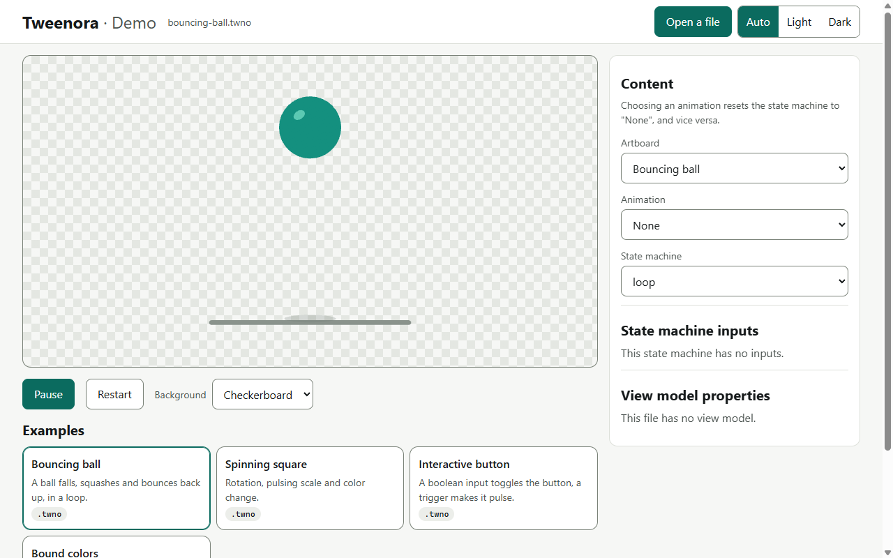

<h1 align="center">Tweenora</h1>

<p align="center">
  <b>Open source vector animation runtime with interactive state machines.</b><br>
  C++ core, WebAssembly + WebGL2 player for the browser, and an open <code>.twno</code> file format. Self-hostable.
</p>

<p align="center">
  
  
  
  
</p>

<p align="center">
  <a href="#features">Features</a> ·
  <a href="#quick-start">Quick start</a> ·
  <a href="#status-and-limits">Status</a> ·
  <a href="#faq">FAQ</a> ·
  <a href="docs/FORMAT_TWNO.md">File format</a>
</p>

<p align="center">
  
</p>

> [!WARNING]
> Early alpha. The runtime has been neither audited nor fuzzed: only open files you trust. Derived from an MIT-licensed upstream runtime (see [NOTICE](NOTICE)); independent project, not affiliated with or endorsed by its authors.

## Why Tweenora

- **Interactive, not just playback.** Animations carry state machines with inputs (numbers, booleans, triggers) you can drive from code or pointer events.
- **Runs in the browser, locally.** WebAssembly + WebGL2 GPU rendering. In the demo your file is opened in the browser and is not uploaded.
- **Open.** MIT code, public specification of the `.twno` format ([`docs/FORMAT_TWNO.md`](docs/FORMAT_TWNO.md)) and its schema, no account, self-hostable.
- **Honest about its state.** Early alpha, no editor yet, measured limits listed below.

## Features

- Plays vector animations and their state machines: choose the animation and the state machine, set inputs live.
- Opens `.twno` files.
- Four original example files, with their generator source, in [`docs/examples/`](docs/examples/).
- C++ runtime in `runtime/`, web player and `@tweenora/webgl2` package (built locally, not yet published on npm) in `web/`.
- Python tools in `tools/`: file reader (`twnoinfo`), `.riv` / `.twno` conversion (`twno_convert`), schema extraction, code-driven example generator (`twno_gen`).

## Quick start

Run the demo and the examples locally from source (the WebAssembly package must be built first, see [`web/README.md`](web/README.md)):

```bash
bash web/build_webgl2_package.sh --no-wasm
python web/examples/prepare_assets.py
python web/examples/serve.py        # http://127.0.0.1:8765/
```

Then drop a `.twno` or `.riv` file on the page, or pick one of the examples.

## The `.twno` format

- A `.twno` file is a `.riv` file (major version 7) with a different 4-byte signature (`TWNR`).
- The runtime reads both; `twno_convert` writes `.twno` files and converts back to `.riv`.
- Specification: [`docs/FORMAT_TWNO.md`](docs/FORMAT_TWNO.md). Types and properties: [`docs/schema/schema.json`](docs/schema/schema.json).

## Status and limits

- Web is the only platform today. An editor, other runtime platforms and a cloud offering are planned, with no date; `editor/`, `platforms/` and `server/` contain no code yet.
- Rendering and state machine behavior are measured against the upstream runtime on the 475 upstream test files kept in the repository, with documented limits (one browser, one GPU, Windows only, no scripting): see [`docs/baseline/`](docs/baseline/). Nothing is promised beyond those measurements. If you find a difference, open an issue.
- No editor yet: files come from other tools, from conversion with `twno_convert`, or from the generator `twno_gen`.

## Folders

| Folder       | Role                                                                          |
|--------------|-------------------------------------------------------------------------------|
| `runtime/`   | C++ runtime; its tests contain upstream files                                 |
| `web/`       | WASM build (WebGL2), `@tweenora/webgl2` package, demo, examples               |
| `tools/`     | `.twno` format tools, comparison bench                                        |
| `docs/`      | format specification, schema, examples, measurement reports                   |
| `platforms/` | runtimes for other platforms (planned)                                        |
| `editor/`    | editor (planned)                                                              |
| `server/`    | cloud (planned)                                                               |

## FAQ

**What is Tweenora?**
An open source runtime that plays interactive vector animations driven by state machines. It has a C++ core and a WebAssembly + WebGL2 player for the browser.

**Is it free and open source?**
Yes. Code written for Tweenora is MIT-licensed, and the derived runtime code keeps its own MIT license. Test files taken from upstream are not covered by that license: see [`NOTICE`](NOTICE).

**Which file formats can it open?**
`.twno`, its own open format. It does not open Lottie JSON or dotLottie files.

**What is a state machine in an animation runtime?**
A set of states and transitions that decide which animation plays, based on inputs such as a boolean, a number or a trigger. A toggle switch, for example, moves between "off" and "on" animations when a pointer or code changes an input.

**Does it have an editor?**
Not yet. An editor is planned, without a date.

**Which browsers work?**
Rendering uses WebGL2. Measurements were made on Chrome only; other browsers are not tested.

**Is it production ready?**
No. It is an early alpha, neither audited nor fuzzed; open only files you trust.

**How do I report a bug or a rendering difference?**
Open an issue with the file (if shareable), your browser and your GPU.

## Contributing

Conventions: [`CONTRIBUTING.md`](CONTRIBUTING.md). Stack and code rules: [`AGENTS.md`](AGENTS.md). Security and untrusted files: [`SECURITY.md`](SECURITY.md). A contribution is offered under the license of the folder it modifies.

## License

Code written for Tweenora: MIT, © 2026 fiaaaansoo. Code derived from the upstream runtime keeps its original MIT license (texts in `runtime/LICENSE` and `web/rive-wasm/LICENSE`). Test files taken from upstream (`.riv`, fonts, audio, images) are not Tweenora works and are not covered by this license: see [`NOTICE`](NOTICE), including the removal procedure. The license of the editor and the server, which do not exist yet, is not set.
